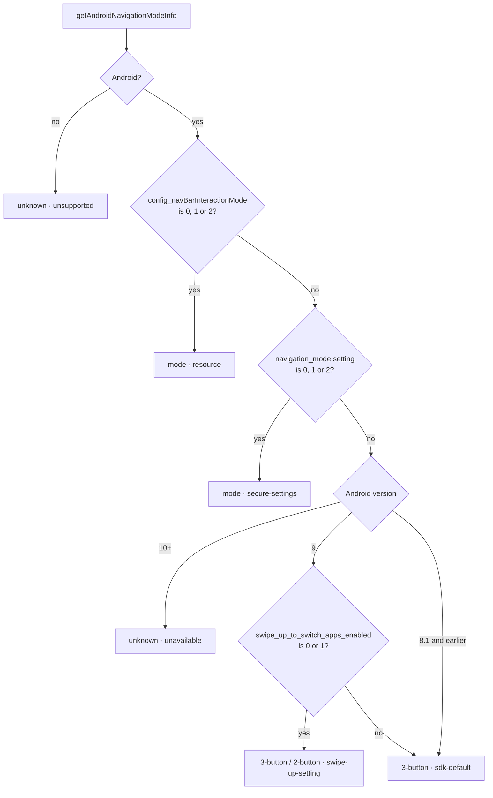

# react-native-android-navigation-mode

Know how the user navigates on Android — gestures, 2 buttons, or 3 buttons — synchronously, and measure the navigation bar of the current window.

## When you need this

- **Edge gestures:** on gesture navigation, swipes from the left/right edge go back. Move carousels, drawers, or swipe-to-delete targets away from the edges, or relax them on button navigation.
- **Bottom sheets and bottom bars:** gesture navigation shows a thin handle; button navigation shows a full bar. Pick a layout that feels right for each.
- **Edge-to-edge UIs:** Android 15 enforces edge-to-edge for apps targeting SDK 35. Read the real navigation bar insets of the window instead of guessing from the mode.
- **Analytics and support:** report which navigation style and data source a device uses.

```ts
import { getAndroidNavigationMode, NAVIGATION_MODE } from "react-native-android-navigation-mode";

if (getAndroidNavigationMode() === NAVIGATION_MODE.GESTURE) {
  // keep swipe targets away from the screen edges
}
```

## Features

- Synchronous detection: no `await`, no loading state, usable outside components.
- `gesture`, `2-button`, `3-button`, plus a detailed result with `unknown` and the data source.
- Hooks that refresh when the app returns to the foreground.
- Navigation bar insets per edge (dp) and bar thickness, updated on rotation and when the bar is shown or hidden.
- Android native code only, no runtime dependencies. On other platforms the API returns documented fallbacks.
- React Native 0.71+, Legacy Architecture and New Architecture (TurboModule generated by Codegen). Expo development builds.

## Installation

```bash
npm install react-native-android-navigation-mode
```

Rebuild the Android app after installing or upgrading. The JS API calls native methods that must exist in the installed binary.

There is nothing to install for iOS: the package has no iOS native code.

### Expo

This package includes **custom native Android code**. It does **not** run inside **Expo Go**. Use a [development build](https://docs.expo.dev/develop/development-builds/introduction/) or a production build (`expo prebuild` / EAS Build).

Autolinking registers the native module. The package also ships a config plugin entry that currently makes no changes, so adding it to `plugins` is optional:

```json
{
  "expo": {
    "plugins": ["react-native-android-navigation-mode"]
  }
}
```

After installing, rebuild native Android (e.g. `npx expo prebuild --clean` then run the dev client, or trigger a new EAS Android build).

## Usage

### Navigation mode

```tsx
import { useAndroidNavigationMode, NAVIGATION_MODE } from "react-native-android-navigation-mode";

function Screen() {
  const mode = useAndroidNavigationMode();
  const edgeSwipeEnabled = mode !== NAVIGATION_MODE.GESTURE;

  return null;
}
```

The hook re-reads the mode when the app becomes **active** again (e.g. the user changed the navigation style in system settings and came back).

### Detailed result with your own fallback

```ts
import { getAndroidNavigationModeInfo, NAVIGATION_MODE } from "react-native-android-navigation-mode";

const info = getAndroidNavigationModeInfo();
// { mode: 'gesture', interactionMode: 2, source: 'resource' }

const mode = info.mode === "unknown" ? NAVIGATION_MODE.THREE_BUTTON : info.mode;
```

```tsx
import { useAndroidNavigationModeInfo } from "react-native-android-navigation-mode";

function NavigationDebug() {
  const { info, error } = useAndroidNavigationModeInfo();

  if (error) {
    // e.g. native module not linked, or the app was not rebuilt after upgrading
    return null;
  }

  return null; // render info.mode / info.source
}
```

### Navigation bar insets with safe-area-context

Navigation mode tells you how the user navigates, not how much space the bar takes: a gesture device still shows a handle, the bar can be hidden, and in landscape it can sit on a side edge. For padding, use insets.

If your app already uses [`react-native-safe-area-context`](https://github.com/AppAndFlow/react-native-safe-area-context), its bottom inset **already includes** the navigation bar. Do not add the navigation bar inset on top of it:

```tsx
import { View } from "react-native";
import { useSafeAreaInsets } from "react-native-safe-area-context";
import { useAndroidNavigationBarInsets } from "react-native-android-navigation-mode";

function BottomBar({ children }) {
  const safeArea = useSafeAreaInsets();
  const { insets: navigationBar } = useAndroidNavigationBarInsets();

  // Padding comes from the safe area only. The navigation bar inset only decides how to style
  // the area behind the bar, e.g. a solid background when a bar is visible at the bottom.
  const barVisibleAtBottom = (navigationBar?.bottom ?? 0) > 0;

  return (
    <View style={{ paddingBottom: safeArea.bottom, backgroundColor: barVisibleAtBottom ? "#ffffff" : "transparent" }}>
      {children}
    </View>
  );
}
```

Use `getAndroidNavigationBarHeight()` when you need the thickness of the bar regardless of its edge.

## API

### `getAndroidNavigationMode(): 'gesture' | '2-button' | '3-button'`

- On Android: returns the detected system mode, or `'3-button'` when it cannot be determined
- On non-Android platforms: returns `'gesture'`
- Throws when the native module is not linked

### `useAndroidNavigationMode(): 'gesture' | '2-button' | '3-button'`

Same values as `getAndroidNavigationMode`, as React state. On Android, updates when `AppState` becomes `active`. On non-Android platforms, always returns `'gesture'`.

### `NAVIGATION_MODE`

Constants for stable comparisons: `NAVIGATION_MODE.GESTURE`, `NAVIGATION_MODE.TWO_BUTTON`, `NAVIGATION_MODE.THREE_BUTTON`.

### `getAndroidNavigationModeInfo(): AndroidNavigationModeInfo`

```ts
type AndroidNavigationModeInfo = {
  mode: 'gesture' | '2-button' | '3-button' | 'unknown';
  interactionMode: 0 | 1 | 2 | null; // 0 = 3-button, 1 = 2-button, 2 = gesture
  source:
    | 'resource'
    | 'secure-settings'
    | 'swipe-up-setting'
    | 'sdk-default'
    | 'unavailable'
    | 'unsupported';
};
```

| `source` | Meaning |
| --- | --- |
| `resource` | System resource `config_navBarInteractionMode` |
| `secure-settings` | Secure setting `navigation_mode`, used when the resource is missing or invalid |
| `swipe-up-setting` | Android 9 secure setting `swipe_up_to_switch_apps_enabled` (swipe-up 2-button mode) |
| `sdk-default` | Android 9 and earlier without a readable value; these versions have no gesture navigation, so `mode` is `'3-button'` |
| `unavailable` | Android 10+ without a valid value; `mode` is `'unknown'` |
| `unsupported` | Not running on Android; `mode` is `'unknown'`, native code is not called |

New `source` values may be added in minor releases. Keep a default branch when switching on it.

Throws when the native module is not linked, or when the installed native code does not provide this method (rebuild the app).

### `useAndroidNavigationModeInfo(): { info: AndroidNavigationModeInfo | null; error: Error | null }`

Reads synchronously on the first render and again when `AppState` becomes `active`. Getter errors are returned as `{ info: null, error }` instead of being thrown; a later successful read clears the error.

### `getAndroidNavigationBarInsets(): Promise<AndroidNavigationBarInsets | null>`

```ts
type AndroidNavigationBarInsets = { top: number; right: number; bottom: number; left: number }; // dp
```

Visible navigation bar insets of the current window.

- Every edge is `0` while the bar is hidden (for example in immersive mode).
- Resolves `null` when there is no activity or window insets yet, and outside Android. `null` is not an error.
- Excludes the status bar, the keyboard, and system gesture areas.
- Rejects when the native module is not linked, or when the installed native code does not provide this method.

### `getAndroidNavigationBarHeight(): Promise<number | null>`

The thickness of the navigation bar: the largest edge of `getAndroidNavigationBarInsets()`. In landscape the bar can be on the left or right, so do not use this value as a bottom padding by default.

### `useAndroidNavigationBarInsets(): { insets: AndroidNavigationBarInsets | null; error: Error | null }`

Starts as `{ insets: null, error: null }`, reads after mount, and updates when the bar is shown or hidden, on rotation, when the activity changes, and when the app returns to the foreground. It observes the window without replacing or consuming your own insets listeners.

## Platform behavior and limits

| Android version | Detection |
| --- | --- |
| 10+ | `config_navBarInteractionMode`, then `navigation_mode` when the resource is missing or invalid; otherwise `unknown` (legacy API: `3-button`) |
| 9 | Same sources, then `swipe_up_to_switch_apps_enabled`; otherwise `3-button` |
| 8.1 and earlier | Same sources; otherwise `3-button` |
| iOS / other platforms | Legacy API `'gesture'`; detailed API `unknown` with `source: 'unsupported'`; insets `null` |



The legacy `getAndroidNavigationMode()` uses the same detection and reports every `unknown` on Android as `'3-button'`.

Detection relies on values the system exposes. Some OEM builds use their own navigation implementations that these values do not reflect, so treat the result as the system's reported mode rather than a guarantee. If a device reports a wrong mode, please open an issue with the output of `getAndroidNavigationModeInfo()`.

## Compatibility

Peer requirements: React Native 0.71+, React 18+. The Android build uses Java/Kotlin target 17 (JDK 17).

Verified on 2026-10-29 with the [example fixtures](example/README.md) (0.76, 0.81, and 0.82 generated with `example/scripts/create-fixture.sh`): release build, then on an Android 16 (API 36) emulator — gesture, 2-button, and 3-button detection, foreground refresh, and navigation bar insets in portrait and landscape. On React Native 0.88 the insets were also checked with the bar hidden (immersive), with the keyboard open (insets unchanged), and next to an app-owned insets listener (still receives every update).

| React Native | Legacy Architecture | New Architecture |
| --- | --- | --- |
| 0.71.19 | Build and runtime verified | Not verified |
| 0.76.9 | Build and runtime verified | Build and runtime verified |
| 0.81.6 | Build and runtime verified | Build and runtime verified |
| 0.82.1 | Not available (React Native 0.82+ always uses the New Architecture) | Build and runtime verified |
| 0.88.1 | Not available | Build and runtime verified, including with the TurboModule interop layer disabled |
| Expo SDK 58 (0.88.1) | Not available | Build and runtime verified (development build path, `expo prebuild`) |

Versions between the rows are expected to work but were not tested individually. Not yet verified on real devices or OEM navigation implementations, or on Android 9 and earlier.

## Testing in your app (Jest)

The package ships untranspiled source. Jest setups based on the React Native preset do not transform `node_modules` packages outside their allow list, so either add the package to `transformIgnorePatterns`:

```js
transformIgnorePatterns: [
  "node_modules/(?!((jest-)?react-native|@react-native(-community)?|react-native-android-navigation-mode)/)",
],
```

or mock it:

```js
jest.mock("react-native-android-navigation-mode", () => ({
  NAVIGATION_MODE: { GESTURE: "gesture", TWO_BUTTON: "2-button", THREE_BUTTON: "3-button" },
  getAndroidNavigationMode: () => "3-button",
  useAndroidNavigationMode: () => "3-button",
  getAndroidNavigationModeInfo: () => ({ mode: "3-button", interactionMode: 0, source: "resource" }),
  useAndroidNavigationModeInfo: () => ({ info: { mode: "3-button", interactionMode: 0, source: "resource" }, error: null }),
  getAndroidNavigationBarInsets: async () => ({ top: 0, right: 0, bottom: 48, left: 0 }),
  getAndroidNavigationBarHeight: async () => 48,
  useAndroidNavigationBarInsets: () => ({ insets: { top: 0, right: 0, bottom: 48, left: 0 }, error: null }),
}));
```

## Contributing

See [CONTRIBUTING.md](CONTRIBUTING.md) and [example/README.md](example/README.md).
