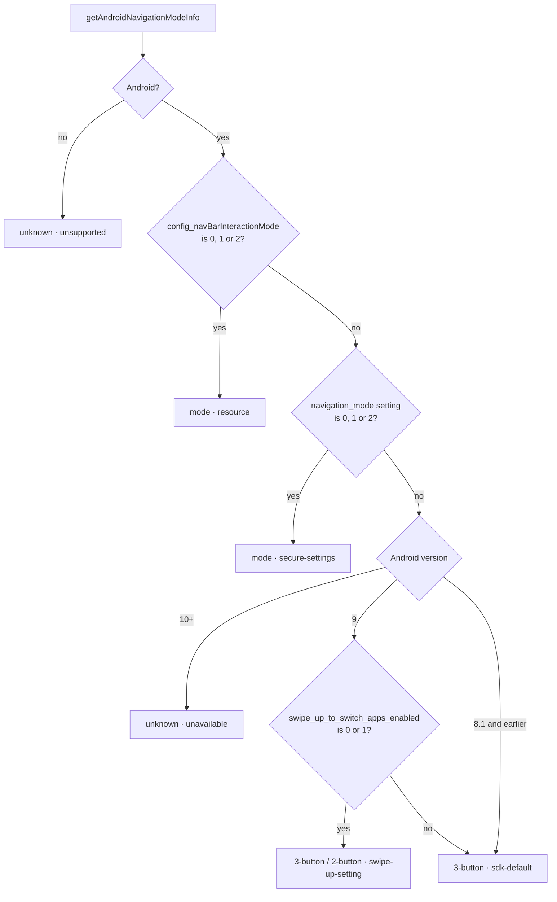

# Detection and platform behavior

## How the mode is detected

| Platform | Result |
| --- | --- |
| Android 10+ | `config_navBarInteractionMode`, then `navigation_mode` when the resource is missing or invalid; otherwise `unknown` |
| Android 9 | Same sources, then `swipe_up_to_switch_apps_enabled`; otherwise `3-button` |
| Android 8.1 and earlier | Same sources; otherwise `3-button` |
| iOS / other platforms | `getAndroidNavigationMode()` returns `'gesture'`; `getAndroidNavigationModeInfo()` returns `unknown` with `source: 'unsupported'`; insets resolve `null` |

`getAndroidNavigationMode()` uses the same detection and reports every `unknown` on Android as `'3-button'`.

Each system read is guarded on its own. A missing value or a rejected read (some Android 12+ builds hide settings keys from apps) moves on to the next source instead of crashing the app.

## Limits

Detection relies on values the system exposes. Some OEM builds use their own navigation implementations that these values do not reflect, so treat the result as the system's reported mode rather than a guarantee. If a device reports a wrong mode, please [open an issue](https://github.com/luongminh2410dev/react-native-android-navigation-mode/issues/new/choose) with the output of `getAndroidNavigationModeInfo()`.

The hooks refresh when the app returns to the foreground. A mode change while the app stays in the foreground is picked up on the next read or the next foreground event.
